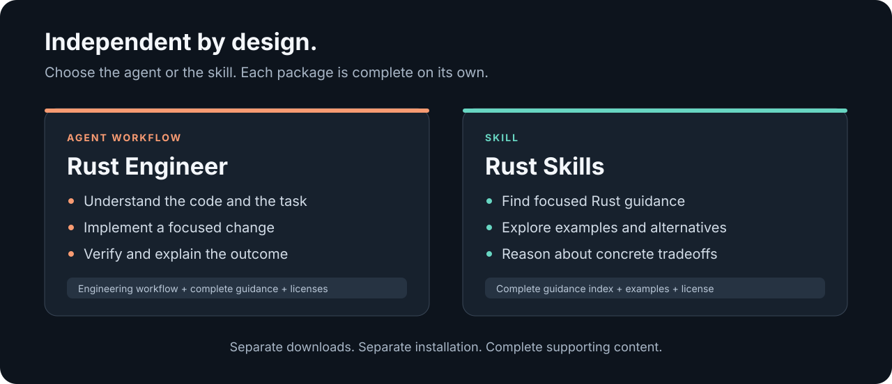
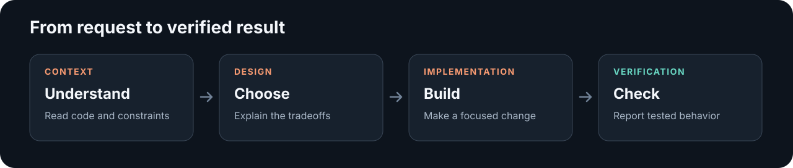

# Rust Programmer

**Independent agent and skill packages for practical Rust development.**

[](https://github.com/vathsaskm/rust-programmer/actions/workflows/check.yml)
[](LICENSE)

[Latest release](https://github.com/vathsaskm/rust-programmer/releases/latest) · [Download the agent](https://github.com/vathsaskm/rust-programmer/releases/download/v1.3.0/rust-engineer-v1.3.0.zip) · [Download the skill](https://github.com/vathsaskm/rust-programmer/releases/download/v1.3.0/rust-skills-v1.3.0.zip)

Rust Engineer helps an agent carry a Rust development task through investigation, implementation, and verification, using a complete bundled Rust best-practices reference. Rust Skills provides the original comprehensive guidance and examples for implementation, review, refactoring, and optimization.

Choose the package that fits your work. Each includes its own instructions, supporting content, and license, and installs on its own.



## Choose what you need

| | Rust Engineer · Agent | Rust Skills · Skill |
| --- | --- | --- |
| **Purpose** | Carry a Rust task through to a verified result | Explain a Rust concept or support a specific design decision |
| **Typical work** | Implementation, debugging, refactoring, and code review | Targeted explanations, examples, and tradeoff analysis |
| **Included** | Engineering instructions, the complete best-practices index and examples, a reference map, display metadata, and licenses | The complete original guidance index, supporting examples, and a license |
| **Installation** | Install the agent package by itself | Install the skill package by itself |

## Install

### Download a release

Get either ZIP from [v1.3.0](https://github.com/vathsaskm/rust-programmer/releases/tag/v1.3.0):

- [Rust Engineer](https://github.com/vathsaskm/rust-programmer/releases/download/v1.3.0/rust-engineer-v1.3.0.zip)
- [Rust Skills](https://github.com/vathsaskm/rust-programmer/releases/download/v1.3.0/rust-skills-v1.3.0.zip)
- [SHA-256 checksums](https://github.com/vathsaskm/rust-programmer/releases/download/v1.3.0/SHA256SUMS)

Compare your download's SHA-256 digest with the matching entry in `SHA256SUMS`, then extract the selected ZIP into your Codex skill directory. On macOS:

```sh
shasum -a 256 rust-engineer-v1.3.0.zip
mkdir -p "$HOME/.agents/skills"
unzip rust-engineer-v1.3.0.zip -d "$HOME/.agents/skills"
```

For Rust Skills, use `rust-skills-v1.3.0.zip` instead. Review an existing installation before replacing it.

### Install from source

```sh
git clone https://github.com/vathsaskm/rust-programmer.git
cd rust-programmer
mkdir -p "$HOME/.agents/skills"
```

Install the agent:

```sh
cp -R skills/rust-engineer "$HOME/.agents/skills/"
```

Or install the skill:

```sh
cp -R skills/rust-skills "$HOME/.agents/skills/"
```

For project-specific use, copy the selected folder into that project's `.agents/skills/` directory. If Codex does not discover it automatically, restart Codex. See the [official installation and invocation documentation](https://learn.chatgpt.com/docs/build-skills).

Rust Engineer is an agent workflow distributed in a Codex skill folder. Its optional display metadata configures how it appears in the app; your host supplies the model, tools, and execution permissions. Other agents can read the Markdown instructions, with installation and invocation adapted to their host.

## Automatic selection

Both packages describe themselves as applicable to every Rust programming or development task. Their descriptions also cover Rust inferred from `.rs` files, `Cargo.toml`, `Cargo.lock`, `rustc`, or the repository context, even when the prompt does not name the language.

Each package explicitly allows implicit invocation in Codex. The descriptions make their purpose visible to the model: Rust Engineer provides the engineering workflow and pre-coding checks; Rust Skills provides the comprehensive reference and examples. The host must expose the installed skill and decides when to invoke it; descriptions cannot force every LLM host or API call to load a skill. See the [official invocation documentation](https://learn.chatgpt.com/docs/build-skills).

Use `$rust-engineer` or `$rust-skills` in Codex when you want to select a package explicitly.

## Use the agent

```text
Use $rust-engineer to investigate this compiler error and implement a fix.
Preserve the public API and verify the affected behavior.
```

```text
Use $rust-engineer to review this Rust change. Explain actionable findings
with file and line evidence, and report the checks actually performed.
```

### Before coding

Rust Engineer first establishes the repository constraints, reads the applicable detailed guidance, and verifies the official documentation for the actual compiler and dependency versions. It records the consulted rule identifiers, documentation evidence, design decisions, and verification approach before editing code.

A required contract that remains unverified keeps the affected implementation behind the gate. The agent can continue independent investigation and use alternative primary sources, including local toolchain documentation and dependency source. Changes in scope or version reopen the relevant checks.



## Use the skill

```text
Use $rust-skills to help me understand the ownership choices in this module.
Show relevant examples and explain the tradeoffs for this code.
```

```text
Use $rust-skills to assess this API design against the crate's compatibility
requirements and explain the alternatives.
```

Start with the [skill index](skills/rust-skills/SKILL.md) and load the supporting material relevant to the task. Apply it in the context of the actual compiler, library version, and repository conventions.

## Choosing libraries

When choosing, adding, or replacing a Rust library, consult the bundled [work matrix](skills/rust-skills/references/library-selection.md) and the relevant category in [Blessed.rs](https://blessed.rs/crates). The agent includes its own complete [copy](skills/rust-engineer/references/rust-guidance/references/library-selection.md).

Start with standard-library support and the project's existing dependencies. Use the catalog to shortlist candidates, then verify their official versioned documentation and fit with the compiler, runtime, target, features, and project constraints. Record the selected crate and rationale before implementation. If the catalog is unavailable, report that limitation and continue with the bundled matrix and primary sources.

## Independence and release quality

Each ZIP is validated in isolation, with the other package absent. Rust Engineer carries its own complete copy of the best-practices reference and examples; it does not require a separate installation. Rust Skills retains the complete original guidance and supporting material, with discovery metadata adapted for broad Rust-task selection and an added library-selection reference. Documentation references stay within their package or point to public reference material.

Repository validation also compares the embedded index, examples, and upstream license against the original source, so packaging changes cannot silently drop or shorten the guidance.

Releases include separate archives and SHA-256 checksums. Validation covers package structure, local references, archive metadata, and common private-data patterns. Gitleaks scans published files, Git history, and release archives; GitHub repeats validation and scanning in CI.

The packages contain no account credentials or machine configuration. Scan results describe the checks performed and do not establish an unconditional security guarantee. See [SECURITY.md](SECURITY.md) for details and private reporting.

## Explore the project

- [Agent instructions](skills/rust-engineer/SKILL.md)
- [Agent reference map](skills/rust-engineer/references/official-rust.md)
- [Agent’s complete best-practices reference](skills/rust-engineer/references/rust-guidance/INDEX.md)
- [Skill index](skills/rust-skills/SKILL.md)
- [Release history](CHANGELOG.md)
- [Validation script](scripts/verify_release.py)

## License and attribution

Rust Engineer and the original repository materials are available under the [MIT license](LICENSE).

Rust Skills includes an attributed snapshot derived from [leonardomso/rust-skills](https://github.com/leonardomso/rust-skills). Its original [license](skills/rust-skills/LICENSE) and attribution are preserved. See [third-party notices](THIRD_PARTY_NOTICES.md) for provenance.

This independent project is not endorsed by the Rust project, OpenAI, or referenced crate authors.
